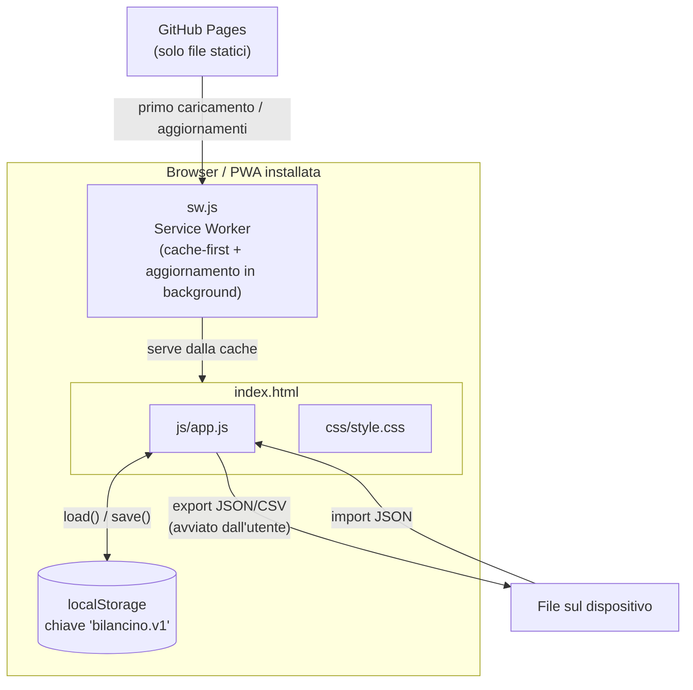
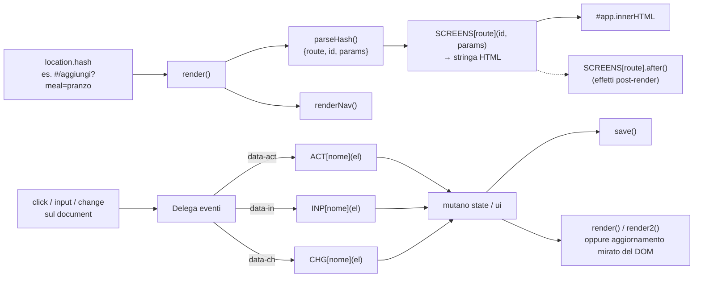

# Bilancino — Product Requirements Document (PRD)

> **Documento di riferimento per persone e agenti AI** che lavorano su questo repository.
> Descrive cosa fa l'app, perché, con quali vincoli e com'è costruita.
> Se il codice e questo documento non coincidono, **il codice è la verità**: aggiorna il PRD nello stesso commit in cui cambi il comportamento.

| Campo | Valore |
|---|---|
| Prodotto | Bilancino — diario alimentare (PWA) |
| Repository | `https://github.com/borelg/bilancino` |
| URL pubblico | `https://borelg.github.io/bilancino/` (GitHub Pages) |
| Proprietario | Gabriele Borelli (`borelg`) |
| Versione app | schema dati `v: 3` · service worker `bilancino-v3` |
| Ultimo aggiornamento PRD | 2026-11-21 (v3) |
| Lingua dell'interfaccia | Italiano (unica lingua supportata) |

---

## 0. Come usare questo documento (per agenti AI)

1. Leggi prima la **§3 Vincoli**: sono non negoziabili, salvo diversa istruzione esplicita del proprietario.
2. Per capire dove mettere le mani, usa la **§6 Architettura** (mappa dei file, flusso, modello dati) e la **§7 Guida all'estensione**.
3. Ogni requisito ha un ID stabile (`FR-…`, `NFR-…`). Citalo nei commit e nelle PR (es. `FR-FAV-02`).
4. Prima di consegnare, esegui la **§9 Verifica** e segui la **§8 Rilascio** (in particolare: incrementa la versione del service worker; migra lo schema se cambi la forma dei dati).
5. Le regole operative sintetiche sono nella **§13 Regole per agenti**.

---

## 1. Visione

Un diario alimentare **gratuito, senza account, senza pubblicità e completamente personalizzabile**, che gira nel browser del telefono e si installa come un'app. L'utente inserisce i propri alimenti con i valori dell'etichetta, crea ricette, salva i pasti ricorrenti, pianifica la settimana e ottiene la lista della spesa, imposta obiettivi di calorie, macro e peso, e consulta grafici e la stima del dispendio reale.

**Terminologia:** nell'interfaccia si dice sempre **"alimento/alimenti"**, mai "prodotto". Nel codice e nei dati resta il nome storico `product`/`products` (route `#/prodotto`) per compatibilità.

**Principio guida:** i dati sono dell'utente e restano sul suo telefono. Niente server, niente tracciamento.

### 1.1 Obiettivi
- **G1:** registrare un pasto abituale in meno di 10 secondi (preferiti, recenti, "come ieri").
- **G2:** registrare un alimento nuovo con i valori dell'etichetta in meno di 60 secondi.
- **G3:** massima personalizzazione: pasti, nutrienti, obiettivi per giorno, schermata principale, tema.
- **G4:** costo di gestione zero: hosting statico gratuito e nessun backend.
- **G5:** funzionamento offline dopo il primo caricamento.

### 1.2 Non-obiettivi (esplicitamente fuori perimetro)
- Account utente, login, sincronizzazione tramite server proprio.
- Database alimentare centralizzato gestito da noi.
- Notifiche push (richiedono un server).
- Integrazione con Google Health Connect o Apple Salute (non accessibili da una web app).
- Pubblicazione sugli store (eventuale fase futura tramite TWA, vedi §11).
- Consigli medici o nutrizionali: l'app registra e calcola, non prescrive.

---

## 2. Utenti e casi d'uso

**Utente tipo:** adulto che vuole controllare calorie e macronutrienti (dimagrimento, ricomposizione, sport), è abituato a leggere le etichette e trova le app commerciali rigide, piene di pubblicità o a pagamento. Usa principalmente uno smartphone Android o iPhone. Attualmente gli utenti sono il proprietario e alcuni amici.

| ID | Caso d'uso |
|---|---|
| UC-1 | A colazione aggiungo la mia "colazione tipo" con un tocco, togliendo ciò che oggi non ho mangiato. |
| UC-2 | Compro un prodotto nuovo: lo creo copiando i valori per 100 g dall'etichetta e definisco la porzione "1 vasetto = 170 g". |
| UC-3 | Cucino un sugo per 4: creo la ricetta, peso la pentola a fine cottura e registro 1 porzione o 250 g. |
| UC-4 | Nei giorni di allenamento voglio più calorie e carboidrati: imposto tipi di giornata diversi per giorno della settimana. |
| UC-5 | Al supermercato apro la lista della spesa generata dai prodotti ricorrenti e spunto ciò che prendo. |
| UC-6 | La domenica controllo l'andamento del peso, la ripartizione media dei macro e le calorie della settimana. |
| UC-7 | Cambio telefono: esporto il backup e lo reimporto sul nuovo. |
| UC-8 | La domenica pianifico i pasti della settimana; l'app mi dà la lista della spesa con le quantità che mancano. |
| UC-9 | Dopo qualche settimana l'app mi dice quante calorie brucio davvero e mi propone di correggere gli obiettivi. |
| UC-10 | Voglio sistemare un alimento o una ricetta senza dover fingere di aggiungerli a un pasto. |

---

## 3. Vincoli (non negoziabili)

| ID | Vincolo |
|---|---|
| C-1 | **Nessun server, nessun backend.** L'app è un insieme di file statici serviti da GitHub Pages. |
| C-2 | **Nessun passo di build** e nessun bundler. I file del repository sono esattamente i file pubblicati. |
| C-3 | **Nessuna dipendenza esterna a runtime**: niente librerie, CDN o font remoti. Solo HTML, CSS e JavaScript "vanilla" (ES2020+). |
| C-4 | **Dati solo in locale** (`localStorage`). Nessun dato personale lascia il dispositivo, salvo export avviato dall'utente. |
| C-5 | **Percorsi relativi** (`./…`): l'app vive in una sottocartella (`/bilancino/`). |
| C-6 | **Interfaccia solo in italiano**, con formati numerici e date `it-IT` (virgola decimale). |
| C-7 | **Mobile first**: progettata per circa 360–430 px di larghezza; contenuto centrato con larghezza massima di 560 px su schermi grandi. |
| C-8 | **Compatibilità**: Chrome Android (recente) e Safari iOS 16.4+ in modalità browser e installata. |
| C-9 | **Retrocompatibilità dei dati**: un aggiornamento non deve mai far perdere i dati esistenti (vedi §6.6 migrazioni). |

---

## 4. Requisiti funzionali

Stato: ✅ implementato · 🟡 parziale · ⬜ non implementato.

### 4.1 Diario (`#/oggi`)
| ID | Requisito | Stato |
|---|---|---|
| FR-DIA-01 | Mostra il giorno selezionato, con navigazione al giorno precedente e successivo; toccando il titolo si torna a oggi. | ✅ |
| FR-DIA-02 | Anello delle calorie: obiettivo, mangiate, rimaste; colore di avviso se l'obiettivo è superato. | ✅ |
| FR-DIA-03 | Barre di proteine, carboidrati e grassi rispetto all'obiettivo, con "mancano X g" oppure "+X g". | ✅ |
| FR-DIA-04 | Riquadro "altri nutrienti" per i nutrienti marcati come visibili, con obiettivo se definito. | ✅ |
| FR-DIA-05 | Inserimento rapido del peso del giorno. | ✅ |
| FR-DIA-06 | Elenco dei pasti configurati, ciascuno con le sue voci, kcal e macro del pasto. | ✅ |
| FR-DIA-07 | Toccando una voce si apre un pannello per modificarne quantità e unità, spostarla di pasto o eliminarla (con "Annulla"). | ✅ |
| FR-DIA-08 | Pasto vuoto: azioni "Come ieri" (se ieri c'era) e "Preferiti e copia". | ✅ |
| FR-DIA-09 | Chip del tipo di giornata: tocco per cambiarlo solo per quella data (override). | ✅ |
| FR-DIA-10 | Messaggio di benvenuto al primo avvio, con link a obiettivi, primo prodotto e alimenti di esempio. | ✅ |
| FR-DIA-11 | Ciascun riquadro (anello, macro, nutrienti, peso) è attivabile o disattivabile da Personalizza. | ✅ |
| FR-DIA-12 | Barra in basso: **Diario · Alimenti · (+) · Progressi · Obiettivi**. Nell'intestazione del Diario: icona del Piano pasti e di Personalizza. | ✅ |
| FR-DIA-13 | Se il piano pasti ha voci non ancora registrate per quel giorno e pasto, compare il chip "Dal piano: …" che le registra con un tocco. | ✅ |
| FR-DIA-14 | Avviso TDEE (solo su "oggi"): appare se la correzione proposta è di almeno 100 kcal e non è stato visto né applicato negli ultimi 7 giorni. Azioni: Applica, Dettagli, Più tardi. | ✅ |

### 4.2 Aggiunta di alimenti (`#/aggiungi`)
| ID | Requisito | Stato |
|---|---|---|
| FR-ADD-01 | Scelta del pasto di destinazione; quello predefinito dipende dall'ora. | ✅ |
| FR-ADD-02 | Ricerca testuale insensibile ad accenti e maiuscole su nome, marca ed etichette. | ✅ |
| FR-ADD-03 | Schede: Recenti, Preferiti, Alimenti, Ricette, Dispensa. **Ordinamento:** Recenti dal più recente al meno recente (anche filtrando con la ricerca); tutte le altre schede in ordine alfabetico (italiano, senza distinzione di maiuscole e accenti, numeri in ordine naturale). | ✅ |
| FR-ADD-04 | Pannello quantità: stepper, input decimale, unità (g/ml, porzioni nominate, porzioni di ricetta), anteprima di kcal e macro, "poi restano". | ✅ |
| FR-ADD-05 | Ricorda l'ultima quantità e unità usate per ogni alimento. | ✅ |
| FR-ADD-06 | "Rapido": voce libera con descrizione e kcal (e macro facoltativi), senza creare un prodotto. | ✅ |
| FR-ADD-07 | Scorciatoie per creare un nuovo alimento o una nuova ricetta; per un alimento nuovo si apre subito il pannello quantità. | ✅ |
| FR-ADD-08 | Scansione del codice a barre. | ⬜ (escluso su richiesta; candidato in roadmap) |

### 4.2b Libreria "Alimenti e ricette" (`#/alimenti`)
| ID | Requisito | Stato |
|---|---|---|
| FR-LIB-01 | Voce della barra in basso. Schede: **Alimenti, Ricette, Preferiti, Dispensa**, ciascuna con il conteggio. | ✅ |
| FR-LIB-02 | Elenchi in ordine alfabetico con ricerca; toccando una voce si apre l'editor e al salvataggio si torna alla stessa scheda. | ✅ |
| FR-LIB-03 | "+ Nuovo"/"+ Nuova" crea un alimento o una ricetta direttamente, senza passare dal diario. | ✅ |
| FR-LIB-04 | Preferiti: pannello di modifica con nome, quantità delle voci, rimozione voci, eliminazione e "Aggiungi al diario". | ✅ |
| FR-LIB-05 | La Dispensa è una scheda della libreria (non più nella barra in basso); `#/dispensa` resta valido e apre questa scheda. | ✅ |

### 4.3 Alimenti (`#/prodotto/:id|new`)
| ID | Requisito | Stato |
|---|---|---|
| FR-PRO-01 | Nome, marca, base dei valori (100 g o 100 ml). | ✅ |
| FR-PRO-02 | Energia, proteine, carboidrati (di cui zuccheri), grassi (di cui saturi), fibre, sale e nutrienti personalizzati. | ✅ |
| FR-PRO-03 | Calcolo automatico delle kcal (`4P + 4C + 9G + 2·fibre`), disattivabile per copiare il valore dell'etichetta. | ✅ |
| FR-PRO-04 | Porzioni con nome (es. "vasetto = 170 g"), con suggerimenti dai nomi già usati. | ✅ |
| FR-PRO-05 | Etichette libere (separate da virgola) e note. | ✅ |
| FR-PRO-06 | Sezione dispensa: "Lo compro regolarmente", frequenza, confezione, reparto (con suggerimenti). | ✅ |
| FR-PRO-07 | Eliminazione con avviso se il prodotto è usato in ricette; le voci di diario esistenti restano. | ✅ |
| FR-PRO-08 | I campi numerici non mostrano i suggerimenti del browser (`autocomplete="off"`); reparto e nome porzione li mantengono tramite `<datalist>`. | ✅ |
| FR-PRO-09 | Campo facoltativo **"In casa adesso"** (g/ml, `product.stock`). | ✅ |

### 4.4 Ricette (`#/ricetta/:id|new`)
| ID | Requisito | Stato |
|---|---|---|
| FR-RIC-01 | Nome, ingredienti (prodotto + grammi), numero di porzioni, peso da cotto facoltativo, procedimento. | ✅ |
| FR-RIC-02 | Riepilogo in tempo reale per porzione: kcal, macro, barra di ripartizione, peso della porzione. | ✅ |
| FR-RIC-03 | Registrazione a porzioni o a grammi (i grammi usano il peso da cotto, se indicato, altrimenti il peso crudo totale). | ✅ |
| FR-RIC-04 | Dal selettore ingredienti si può creare un nuovo prodotto senza perdere la ricetta in corso. | ✅ |

### 4.5 Pasti preferiti
| ID | Requisito | Stato |
|---|---|---|
| FR-FAV-01 | Dalla stellina ☆ di un pasto nel diario: salva le sue voci come preferito con un nome. | ✅ |
| FR-FAV-02 | Applicazione di un preferito: scelta delle voci (spunte), del pasto di destinazione e anteprima dei totali. | ✅ |
| FR-FAV-03 | I valori dei preferiti si **ricalcolano** dai prodotti e dalle ricette attuali; si usa lo snapshot salvato solo se l'origine è stata eliminata. | ✅ |
| FR-FAV-04 | Rinomina ed elimina un preferito. | ✅ |
| FR-FAV-05 | "Copia da un altro giorno": copia tutte le voci di un pasto da una data qualsiasi. | ✅ |

### 4.6 Dispensa e lista della spesa (`#/dispensa`, `#/spesa`)
| ID | Requisito | Stato |
|---|---|---|
| FR-DIS-01 | Elenco dei prodotti ricorrenti raggruppati per reparto, con filtro per frequenza. | ✅ |
| FR-DIS-02 | Casella per mettere un prodotto in lista e "+" per registrarlo nel diario. | ✅ |
| FR-DIS-03 | "Metti tutti in lista" per la frequenza filtrata. | ✅ |
| FR-DIS-04 | Lista della spesa per reparto, voci libere aggiuntive, spunta di ciò che si prende, "Fine spesa" che toglie i presi. | ✅ |
| FR-DIS-05 | **Quantità in casa:** scende automaticamente quando si registra nel diario un alimento o una ricetta che lo contiene (mai sotto zero; solo se è > 0); sale quando si chiude la spesa degli alimenti del piano spuntati. Le voci eliminate dal diario non la ripristinano. | ✅ |
| FR-DIS-06 | La lista della spesa ha in cima la sezione **"Dal piano pasti"** (vedi FR-PLAN-05). | ✅ |

### 4.6b Piano pasti settimanale (`#/piano`)
| ID | Requisito | Stato |
|---|---|---|
| FR-PLAN-01 | Settimana da lunedì a domenica con navigazione tra le settimane; i giorni vuoti sono compatti, oggi è evidenziato. | ✅ |
| FR-PLAN-02 | "+ Pianifica" su un giorno: scelta del pasto e di una ricetta (1 porzione), un preferito (×1) o un alimento (ultima quantità usata oppure 100 g); si possono aggiungere più voci prima di chiudere il pannello. | ✅ |
| FR-PLAN-03 | Ogni voce pianificata ha quantità modificabile (porzioni, g/ml o moltiplicatore del preferito) e può essere tolta, con "Annulla". Ogni giorno mostra le kcal pianificate rispetto all'obiettivo del suo tipo di giornata. | ✅ |
| FR-PLAN-04 | "Registra nel diario" (per giorno, oppure per pasto dal Diario) crea le voci nel diario e segna quelle pianificate come registrate (✓). I preferiti vengono scomposti nelle loro voci. | ✅ |
| FR-PLAN-05 | **Spesa automatica:** per il periodo scelto (prossimi 7 giorni · fino a domenica · settimana prossima) somma i grammi degli alimenti delle voci pianificate **non ancora registrate** (le ricette e i preferiti vengono scomposti negli ingredienti), sottrae la quantità in casa e mostra quanto comprare, con la stima in confezioni o porzioni. Gli alimenti già coperti compaiono come "Già in casa". | ✅ |
| FR-PLAN-06 | "Copia settimana precedente" (aggiunge, non sostituisce) e "Svuota settimana" (il diario non cambia). | ✅ |

### 4.7 Obiettivi (`#/obiettivi`)
| ID | Requisito | Stato |
|---|---|---|
| FR-OBI-01 | Peso obiettivo e ritmo settimanale; stima della data di arrivo e del deficit o surplus (7.700 kcal/kg). | ✅ |
| FR-OBI-02 | Tipi di giornata con kcal, proteine, carboidrati, grassi e obiettivi per i nutrienti visibili. | ✅ |
| FR-OBI-03 | Modalità "Sempre uguali" (un tipo fisso) o "Per giorno" (un tipo per ogni giorno della settimana, con colori e legenda). | ✅ |
| FR-OBI-04 | Mostra la ripartizione %, i g/kg di proteine e lo scarto tra le kcal dai macro e quelle impostate, con "Usa questo". | ✅ |
| FR-OBI-05 | Riquadro "Dispendio reale" (FR-TDEE-*), anche in Progressi. | ✅ |

### 4.7b Dispendio reale — TDEE adattivo
| ID | Requisito | Stato |
|---|---|---|
| FR-TDEE-01 | Stima del dispendio energetico reale dagli ultimi 28 giorni (oggi escluso): media delle kcal delle giornate registrate meno la variazione del peso convertita in kcal (formula in §6.8). | ✅ |
| FR-TDEE-02 | Servono almeno **14 giornate registrate**, **4 pesate** e **10 giorni** tra la prima e l'ultima pesata; altrimenti mostra i progressi verso queste soglie. Risultati fuori da 1.000–6.000 kcal vengono scartati con un messaggio. | ✅ |
| FR-TDEE-03 | Proposta: kcal giornaliere per il ritmo scelto (`goals.rate`) confrontate con la media degli obiettivi dei prossimi 7 giorni; se lo scarto è ≥ 50 kcal compare "Applica". | ✅ |
| FR-TDEE-04 | "Applica" somma lo scarto alle kcal di **tutti** i tipi di giornata (arrotondate a 10, minimo 800), mantiene le proteine e divide la differenza tra carboidrati e grassi in proporzione alle loro kcal attuali. Registra la revisione in `state.tdee`. | ✅ |

### 4.8 Progressi (`#/progressi`)
| ID | Requisito | Stato |
|---|---|---|
| FR-PRG-01 | Periodo selezionabile: **1S** (7 giorni), 1M, 3M, 6M, 1A. | ✅ |
| FR-PRG-02 | Grafico del peso: pesate a pallini, media mobile 7 giorni a linea, linea dell'obiettivo. | ✅ |
| FR-PRG-03 | Statistiche: media kcal, giorni con proteine ≥ 95% dell'obiettivo, giorni tracciati. | ✅ |
| FR-PRG-04 | Grafico a torta dei macro (% delle kcal da macro), con menu Oggi / Media 7 gg / Media 30 gg / Media di sempre, obiettivi a fianco e anello esterno con la ripartizione obiettivo. Le medie usano solo i giorni con almeno una voce. | ✅ |
| FR-PRG-05 | Barre delle calorie impilate per macro (P, C, G, "Altro" = kcal senza macro), con tacche cumulative degli obiettivi (P, P+C, P+C+G se diversa dalle kcal, kcal tratteggiate). Oltre 45 giorni: medie settimanali. | ✅ |
| FR-PRG-06 | Tocco su una barra: dettaglio di kcal e macro rispetto agli obiettivi. | ✅ |
| FR-PRG-07 | Registrazione di peso e misure corporee personalizzabili per data, con storico e cancellazione (con "Annulla"). | ✅ |

### 4.9 Personalizzazione e dati (`#/personalizza`)
| ID | Requisito | Stato |
|---|---|---|
| FR-SET-01 | Pasti: rinomina, riordina, aggiungi, elimina (almeno 1). | ✅ |
| FR-SET-02 | Nutrienti: mostra o nascondi; crea o elimina nutrienti personalizzati (nome + unità). | ✅ |
| FR-SET-03 | Elementi della schermata Diario attivabili; "mostra quanto manca" invece del consumato. | ✅ |
| FR-SET-04 | Tema: Chiaro (predefinito), Scuro, Come il telefono. | ✅ |
| FR-SET-05 | Export del backup JSON completo; import con sostituzione totale previa conferma. | ✅ |
| FR-SET-06 | Export del diario in CSV (separatore `;`, BOM UTF-8, virgola decimale: si apre bene in Excel italiano). | ✅ |
| FR-SET-07 | Alimenti di esempio (16, valori indicativi, etichetta `esempio`). | ✅ |
| FR-SET-08 | Cancellazione di tutti i dati con doppia conferma. | ✅ |

---

## 5. Requisiti non funzionali

| ID | Requisito |
|---|---|
| NFR-01 Prestazioni | Avvio interattivo in meno di 1 s su un telefono medio; un aggiornamento di schermata in meno di 50 ms con un anno di dati. |
| NFR-02 Offline | Dopo la prima visita tutte le funzioni sono disponibili senza rete (service worker). |
| NFR-03 Peso | Nessuna dipendenza; il totale dei file di testo resta sotto i 200 KB. |
| NFR-04 Accessibilità | Elementi interattivi reali (`<button>`, `<a>`, `<input>` con `<label>`); `aria-label` sui pulsanti con sola icona; area di tocco ≥ 44 px; contrasto del testo ≥ 4,5:1; i colori dei macro sono sempre accompagnati da un'etichetta testuale. |
| NFR-05 Sicurezza | Ogni testo inserito dall'utente passa da `esc()` prima di finire nell'HTML (prevenzione XSS). Nessun `eval`. |
| NFR-06 Privacy | Nessuna chiamata di rete oltre ai file dell'app. Nessuna analisi d'uso. |
| NFR-07 Robustezza | I dati si salvano con un ritardo di 150 ms e subito su `pagehide` o quando la pagina diventa nascosta; se lo spazio è pieno appare un avviso. |
| NFR-08 iOS | Input con font ≥ 16 px (evita lo zoom); export tramite il foglio di condivisione su iPhone. |

---

## 6. Architettura

### 6.1 Panoramica

App a pagina singola (SPA) **senza framework**, in un unico file JavaScript. Lo stato vive in un oggetto globale salvato in `localStorage`. Ogni cambio di schermata **ricostruisce l'HTML** della schermata da funzioni che restituiscono stringhe (template literal). Gli eventi sono gestiti per **delega** tramite attributi `data-*`.



**Flusso interno di `app.js`:**



### 6.2 Struttura dei file

```
/
├── index.html            # Pagina unica: contenitori #app, #nav, #sheet, #scrim, #toast; carica CSS e JS
├── css/style.css         # Tutto lo stile: variabili di tema (chiaro/scuro), componenti, layout
├── js/app.js             # Tutta la logica (~1.700 righe), script classico (non modulo), 'use strict'
├── sw.js                 # Service worker: precache dei file + strategia di cache
├── manifest.webmanifest  # Metadati della PWA (nome, icone, colori, start_url "./")
├── icons/                # icon-192, icon-512, icon-maskable-512, apple-touch-icon (PNG)
├── README.md             # Guida per l'utente: pubblicazione, installazione, backup
└── PRD.md                # Questo documento
```

### 6.3 Mappa di `js/app.js` (in ordine di file)

| Sezione | Contenuto principale |
|---|---|
| Utilità | `$`, `uid`, `esc`, `num` (parsing con virgola), `round`, `fmt` (`it-IT`), `fmtIn` (valore per input), date in stringa `YYYY-MM-DD` (`ds`, `today`, `toDate` alle 12:00 per evitare problemi di fuso, `addDays`, `weekday` con lunedì = 0), `norm` (minuscole senza accenti), `byName` (ordinamento alfabetico) |
| Icone | `ICONS` (path SVG stile tratto), `ic(nome, size, stroke)` |
| Stato | `defaultState()`, `load()` (merge con i default + migrazioni), `state`, `save(now)`, oggetto `ui` |
| Calcoli nutrizionali | `CORE`, `MACROS`, `scaleN`, `addN`, `kcalFrom`, `per100`, `gramsOf`, `productN`, `recipeInfo`, `recipeN`, `sourceOf`, `nutrOf`, `qtyLabel`, `dayType`, `dayTotals`, `latestWeight`, `guessMeal` |
| Router | `parseHash`, `go`, `SCREENS`, `NAV_ROUTES`, `render`, `renderNav` |
| Toast / sheet | `toast(msg, {label, fn})`, `openSheet(html, ctx)`, `closeSheet()` |
| Schermate | `SCREENS.oggi`, `.aggiungi` (+ `.after`), `.prodotto`, `.ricetta`, `.alimenti` (libreria: `libList`, `dispensaBody`), `.dispensa` (alias), `.spesa` (`shopPlan`, `packHint`), `.piano`, `.obiettivi`, `.progressi`, `.personalizza` |
| Pannelli (sheet) | quantità (`openQtySheet`, `qtySheetHtml`, `qtyPreview`, `confirmQty`), rapido (`quickSheetHtml`, `saveQuick`), preferito da applicare (`favSheetHtml`, `openFav`), modifica preferito (`favEditHtml`), strumenti pasto (`mealToolsHtml`), selettore ingredienti (`pickerSheetHtml`), selettore del piano (`planPickerHtml`, `planPickList`) |
| Piano pasti | `mondayOf`, `planItemSrc`, `planItemN`, `planUnitLabel`, `expandProducts` (scompone voci in grammi di alimenti), `planNeeds`, `consumeStock`, `logPlanItems` |
| TDEE | `tdeeCalc` (calcolo puro), `tdeeCard`, `tdeeBanner`, `applyTdee`; costanti `TDEE_WINDOW`, `TDEE_MIN_*` |
| Grafici | `weightChart`, `kcalChart` + `kDetail` (usa `kPts`), `macroPie`, `measuresSummary` — tutti SVG generati come stringa |
| Gestori | `ACT` (click), `INP` (input mentre si digita), `CHG` (change a fine modifica) + i 4 listener globali (`click`, `keydown`, `input`, `change`) |
| Dati di esempio | `EXAMPLES` (tuple `[nome, base, kcal, p, c, f, fibre, porzioni]`) |
| Avvio | tema, `render()`, controllo del cambio di giorno a mezzanotte, registrazione del service worker, `navigator.storage.persist()` |

### 6.4 Routing

L'hash ha la forma `#/<route>[/<id>][?query]`. Una route sconosciuta mostra `oggi`.

| Route | Schermata | Parametri | Barra di navigazione |
|---|---|---|---|
| `#/oggi` (o vuoto) | Diario del giorno `ui.date` | — | sì |
| `#/aggiungi` | Aggiungi alimento | `meal=<mealId>`, `tab=recenti\|preferiti\|prodotti\|ricette\|dispensa`, `open=p:<productId>\|r:<recipeId>` (apre subito il pannello quantità, poi viene tolto dall'URL con `replaceState`) | no |
| `#/prodotto/new` · `#/prodotto/<id>` | Editor prodotto | `ret=add` (dopo il salvataggio apre il pannello quantità), `ret=recipe` (torna alla ricetta e aggiunge l'ingrediente), `ret=<hash>` (torna lì), `name=<testo>` (precompila), `pantry=1` (dispensa attiva) | no |
| `#/ricetta/new` · `#/ricetta/<id>` | Editor ricetta | `ret=<hash>` (dove tornare dopo salvataggio o eliminazione; predefinito: libreria, scheda Ricette) | no |
| `#/alimenti` | Libreria Alimenti e ricette | `tab=alimenti\|ricette\|preferiti\|dispensa` | sì |
| `#/dispensa` | Alias: libreria, scheda Dispensa | — | sì (evidenzia Alimenti) |
| `#/spesa` | Lista della spesa (piano + dispensa + voci libere) | — | no |
| `#/piano` | Piano pasti settimanale | `w=<lunedì YYYY-MM-DD>` | no |
| `#/obiettivi` | Obiettivi | — | sì |
| `#/progressi` | Progressi e grafici | — | sì |
| `#/personalizza` | Impostazioni e dati | — | no |

**Bozze:** gli editor lavorano su una copia (`ui.pDraft`, `ui.rDraft`) contrassegnata con `_for = id` (la ricetta anche con `_ret`, la destinazione di ritorno). `render()` scarta `pDraft` quando si esce da `prodotto`, e `rDraft` quando si esce da `ricetta` o `prodotto` (così la ricetta sopravvive alla creazione di un ingrediente). I campi `_for` e `_ret` vengono rimossi al salvataggio.

### 6.5 Rendering ed eventi

- **Rendering:** `render()` chiude l'eventuale pannello, chiama la funzione della schermata, assegna `#app.innerHTML`, aggiorna la barra di navigazione e il tema. `render2()` fa lo stesso preservando lo scroll.
- **Aggiornamenti mirati** (per non perdere il focus mentre si scrive): ricerca (`#addList`, `#libList`, `#planList`, `#pickList`), modifica preferito (`#fk-<i>`, `#favEditTot`), anteprima quantità (`#qprev`), riepilogo ricetta (`#rsum`), kcal automatiche (`#pn-kcal`), stima del peso (`#gEst`), informazioni sul tipo di giornata (`#dti-<id>`), torta (`#pieBox`), dettaglio delle barre (`#kDetail`).
- **Delega eventi:**

| Attributo | Evento | Tabella | Uso |
|---|---|---|---|
| `data-act="nome"` | `click` | `ACT` | pulsanti, link-azione, barre del grafico. Altri parametri in `data-*` (`data-id`, `data-i`, `data-meal`, …). |
| `data-in="nome"` | `input` | `INP` | campi che aggiornano mentre si digita (bozze, ricerca, quantità). |
| `data-ch="nome"` | `change` | `CHG` | campi salvati a fine modifica (obiettivi, impostazioni, checkbox, select, import file). |

- **Pannelli (bottom sheet):** `openSheet(html, ctx)` imposta `ui.sheet = ctx` (con `ctx.type` = `qty` \| `quick` \| `fav` \| `favEdit` \| `tools` \| `picker` \| `planPick`). Si chiudono toccando lo sfondo, con Esc o con `closeSheet()`. Se il pannello ha modificato dati mostrati dietro, imposta `ctx.dirty = true`: alla chiusura la schermata viene ridisegnata.
- **Toast:** `toast(msg, {label, fn})`, in alto, 2,2 s (5 s se c'è un'azione, es. "Annulla"). Non intercetta i tocchi, salvo sul suo pulsante.
- **Dialoghi nativi:** `confirm()` per le eliminazioni, `prompt()` per inserire brevi nomi (nutriente, misura, pasto, preferito).

### 6.6 Persistenza e migrazioni

- **Chiave:** `localStorage['bilancino.v1']` contiene tutto `state` in JSON. Il nome della chiave è **storico e fisso**: non va cambiato. La versione dello schema è `state.v`.
- **Salvataggio:** `save()` con ritardo di 150 ms; `save(true)` immediato. Sempre immediato su `pagehide` e `visibilitychange` (pagina nascosta).
- **Caricamento:** `load()` fa il parse e completa le chiavi mancanti di primo livello, `settings` e `goals` con i default, poi applica le migrazioni.
- **Migrazioni esistenti:**
  - `v1 → v2`: se `settings.theme === 'auto'` diventa `'light'`; imposta `v = 2`.
  - `v2 → v3`: solo aggiunte — `plan = {}`, `tdee = { lastReview: null, history: [] }`, `shopping.planChecked = {}` (più `shopping.checked`/`extra` se assenti); imposta `v = 3`. Nessun valore esistente viene modificato. `product.stock` è facoltativo (assente = 0).
  - Le aggiunte annidate (es. dentro `shopping`) vanno completate **esplicitamente** in `load()`: il merge automatico con i default copre solo il primo livello, `settings` e `goals`.
- **Verifica di compatibilità obbligatoria:** prima di rilasciare un cambio di schema, crea uno stato con la versione pubblicata, aprilo con la nuova e confronta: ogni chiave/valore preesistente deve restare identico (è stato fatto per v2 → v3).
- **Regola per nuove migrazioni:** incrementa `v` in `defaultState()` e aggiungi in `load()` un blocco `if (s.v < N) { …; s.v = N; }` **idempotente**, che non distrugge dati.
- **Snapshot nel diario:** ogni voce salva i valori calcolati (`entry.n`) al momento della registrazione. Modificare o eliminare un prodotto **non** cambia lo storico. Fanno eccezione la modifica della quantità di una voce (ricalcolata dall'origine attuale) e i preferiti (FR-FAV-03).

### 6.7 Modello dati

Notazione TypeScript, solo documentativa. Le date sono stringhe `YYYY-MM-DD` nel fuso locale; gli id sono stringhe da `uid()`.

```ts
type NutrientMap = {           // valori assoluti o per 100 g/ml
  kcal?: number; p?: number; c?: number; f?: number;   // nucleo: kcal, proteine, carboidrati, grassi (g)
  [nutrientId: string]: number | undefined;            // fiber, sugar, sat, salt, n_<uid> (personalizzati)
};

interface State {
  v: 3;
  settings: {
    meals: { id: string; name: string }[];                       // ordine = ordine nel diario
    nutrients: { id: string; name: string; unit: string; visible: boolean; builtin: boolean; parent?: 'c' | 'f' }[];
    home: { ring: boolean; macros: boolean; nutrients: boolean; weight: boolean };
    showRemaining: boolean;
    theme: 'light' | 'dark' | 'auto';
    measures: string[];                                          // nomi delle misure corporee (cm)
    aisles: string[];                                            // reparti suggeriti
  };
  goals: {
    mode: 'fixed' | 'week';
    fixed: string;                                               // id del tipo di giornata in modalità fissa
    week: string[];                                              // 7 id di tipi di giornata, lunedì → domenica
    dayTypes: { id: string; name: string; kcal: number; p: number; c: number; f: number; extra: NutrientMap }[];
    target: number | null;                                       // peso obiettivo in kg
    rate: number;                                                // kg/settimana (negativo = dimagrire)
  };
  dayOverride: Record<string /*data*/, string /*dayTypeId*/>;
  products: Record<string, Product>;
  recipes: Record<string, Recipe>;
  diary: Record<string /*data*/, DiaryEntry[]>;
  favorites: Favorite[];
  plan: Record<string /*data*/, PlanItem[]>;                      // piano pasti
  tdee: { lastReview: string | null /*data*/; history: { date: string; tdee: number; delta: number }[] /*max 60*/ };
  weights: { date: string; kg: number }[];                       // al massimo una pesata per data
  measures: { date: string; name: string; value: number }[];
  shopping: {
    checked: Record<string /*productId*/, boolean>;               // presi tra gli alimenti ricorrenti in lista
    extra: { id: string; name: string; checked: boolean }[];       // voci libere
    planChecked: Record<string /*productId*/, boolean>;           // presi tra gli alimenti del piano
  };
  welcomeDone: boolean;
}

interface Product {
  id: string; name: string; brand: string;
  basis: 'g' | 'ml';
  per100: NutrientMap;                 // valori per 100 g o 100 ml
  autoKcal: boolean;                   // true → kcal = 4p + 4c + 9f + 2·fiber
  servings: { id: string; name: string; qty: number }[];   // qty in g/ml
  tags: string[]; notes: string;
  pantry: { on: boolean; freq: 'settimana' | '2settimane' | 'mese' | 'occasionale'; aisle: string; pack: string; inList: boolean };
  stock?: number;                      // quantità in casa (g/ml); assente = 0
  created?: number; lastUsed?: number; lastQty?: number; lastUnit?: string; uses?: number;
}

interface Recipe {
  id: string; name: string; notes: string;
  items: { pid: string; qty: number }[];   // pid = productId, qty in g/ml crudi
  servings: number;
  cooked: number | null;                    // peso totale da cotto in g (facoltativo)
  created?: number; lastUsed?: number; lastQty?: number; lastUnit?: string; uses?: number;
}

type Unit = 'g' | 'portion' | 'quick' | string /* id di una porzione del prodotto */;

interface DiaryEntry {
  id: string; meal: string /*mealId*/;
  kind: 'product' | 'recipe' | 'quick';
  ref: string | null;                       // productId o recipeId; null per 'quick'
  qty: number; unit: Unit;
  label: string;                            // nome al momento della registrazione
  n: NutrientMap;                           // SNAPSHOT dei valori assoluti della voce
}

interface PlanItem {
  id: string; meal: string /*mealId*/;
  kind: 'product' | 'recipe' | 'fav';
  ref: string;                              // productId, recipeId o favoriteId
  qty: number;                              // g/ml o porzioni; per 'fav' è un moltiplicatore (1 = il pasto intero)
  unit: Unit | 'fav';
  logged?: boolean;                         // true dopo "Registra nel diario"
}

interface Favorite {
  id: string; name: string; meal: string; created: number; lastUsed?: number;
  items: { kind: DiaryEntry['kind']; ref: string | null; qty: number; unit: Unit; label: string; n: NutrientMap }[];
}
```

**Invarianti:**
- Ogni `goals.week[i]` e `goals.fixed` esiste in `dayTypes`; alla cancellazione di un tipo, i riferimenti tornano al primo.
- `dayTypes` e `meals` hanno sempre almeno un elemento.
- Le voci di diario con un `meal` non più esistente restano nei dati, ma non vengono mostrate.
- I nutrienti `builtin` (`fiber`, `sugar`, `sat`, `salt`) non si eliminano; `sugar` e `sat` sono sotto-voci (`parent`) di carboidrati e grassi.

### 6.8 Formule

| Grandezza | Formula |
|---|---|
| Kcal automatiche di un prodotto | `4·P + 4·C + 9·G + 2·fibre` (per 100 g/ml) |
| Valori di una voce prodotto | `per100 × grammi / 100`, dove `grammi = qty` se l'unità è `g`, altrimenti `qty × porzione.qty` |
| Totali di una ricetta | somma degli ingredienti; `peso = cooked ?? somma dei grammi crudi`; porzione = `peso / servings` |
| Voce di una ricetta | a porzioni: `totali × qty / servings`; a grammi: `totali × qty / peso` |
| Tipo di giornata per una data | `dayOverride[data]` ?? (modalità `week` ? `week[giorno]` : `fixed`) |
| Media mobile del peso | media delle pesate nei 7 giorni fino alla data inclusa |
| Stima di arrivo | `settimane = |obiettivo − ultimo peso| / |rate|`; deficit giornaliero ≈ `|rate| × 7700 / 7` |
| Torta dei macro | quote di `4P`, `4C`, `9G` sulla loro somma (le kcal "altro" sono escluse) |
| Barre impilate | segmenti `4P`, `4C`, `9G` e `altro = max(0, kcal − somma)`; tacche a `4Pobj`, `4Pobj + 4Cobj`, `+ 9Gobj`, `kcal obj` |
| "Proteine ok" | giorni con `P ≥ 0,95 × obiettivo` |
| TDEE adattivo | finestra di 28 giorni fino a ieri. `intake` = media delle kcal delle giornate con voci e kcal > 0. `slope` = pendenza (kg/giorno) della retta di regressione sulle pesate da 3 giorni prima della finestra fino a oggi. `TDEE = intake − slope × 7700` (arrotondato a 10) |
| Kcal suggerite | `TDEE + rate × 7700 / 7` (arrotondate a 10); scarto = suggerite − media delle kcal obiettivo dei prossimi 7 giorni |
| Applica TDEE (per tipo di giornata) | `kcal += Δ`; `C += Δ · (4C / (4C + 9G)) / 4`; `G += Δ · (9G / (4C + 9G)) / 9`; P invariato |
| Fabbisogno della spesa | per ogni voce pianificata non registrata nel periodo: alimento → grammi; ricetta → ingredienti × (porzioni / servings oppure grammi / peso); preferito → le sue voci × moltiplicatore. Da comprare = `max(0, somma − stock)` |
| Stima confezioni | `ceil(da comprare / porzione più grande)` se la porzione più grande è ≥ 20 g |

### 6.9 Service worker e PWA

- **Precache** all'installazione: `./`, `index.html`, CSS, JS, manifest, icone. Poi `skipWaiting()` e `clients.claim()`.
- **Fetch:** solo GET dello stesso dominio, **stale-while-revalidate**. Risponde subito dalla cache (ignorando la query string) e intanto aggiorna la cache dalla rete. Se il file non è in cache usa la rete; offline, una navigazione riceve `index.html`.
- **Aggiornamenti:** il nome della cache è `VERSION` in `sw.js`. Va incrementato **a ogni rilascio**: le vecchie cache vengono eliminate in `activate`. L'utente vede la nuova versione alla seconda apertura.
- **Manifest:** `display: standalone`, `start_url` e `scope` = `./`, colori `#1F7A4D` / `#F4F5F1`, icona maskable separata.

### 6.10 Stile e temi

- Tutti i colori sono **variabili CSS** in `:root` (chiaro). Il tema scuro le ridefinisce su `[data-theme="dark"]` e, con `[data-theme="auto"]`, in `@media (prefers-color-scheme: dark)`. L'attributo sta su `<html>`.
- Colori semantici dei macro: `--prot` (blu), `--carb` (arancio), `--fat` (viola); hanno anche luminosità diverse tra loro (leggibili per chi ha deficit di colore).
- Componenti riusabili (classi): `card`, `btn` (`ghost`, `soft`, `plain`, `danger`, `sm`, `block`), `icon-btn`, `chip`, `seg`, `field`/`input`, `list`/`li`, `formrow`, `sheet`, `nav`, `footer-bar`, `floating`, `toast`, `empty`, `tile`, `week`, `chart`.
- Regola globale `[hidden] { display: none !important; }`: senza di essa i componenti con `display: flex` ignorerebbero `hidden`.
- Font di sistema; "Space Grotesk" è indicato per titoli e numeri ma **non viene scaricato** (C-3): se non è installato si usa Inter o il font di sistema.

### 6.11 Grafici

SVG generati come stringa, con `viewBox` fisso (340 px di larghezza) e `width: 100%`. Colori solo tramite variabili CSS, così seguono il tema. Ogni grafico ha `role="img"` e un `aria-label` descrittivo, più una legenda testuale. Le barre del grafico calorie sono gruppi `<g data-act="kbar">` con un rettangolo trasparente a tutta altezza per facilitare il tocco.

---

## 7. Guida all'estensione

**Aggiungere una schermata**
1. Definisci `SCREENS.nome = function (id, params) { return '…html…'; }` (facoltativo `SCREENS.nome.after`).
2. Se deve avere la barra in basso, aggiungi `nome` a `NAV_ROUTES` e un link in `renderNav()`.
3. Collegala con `<a href="#/nome">` o `go('#/nome')`.

**Aggiungere un'azione**
- Nel markup: `<button data-act="miaAzione" data-id="…">`. In `ACT`: `miaAzione(el) { …; save(); render(); }`.
- Per campi di testo usa `data-in` (aggiornamento mentre si digita, senza ri-render completo) oppure `data-ch` (a fine modifica).

**Aggiungere un campo ai dati**
1. Aggiungilo a `defaultState()` (o a `newProduct()` e simili).
2. Se i dati esistenti hanno bisogno di un valore diverso dal default, scrivi una **migrazione** (§6.6) e incrementa `v`.
3. Aggiorna il modello dati nella §6.7 di questo documento.

**Aggiungere un nutriente predefinito:** aggiungilo a `settings.nutrients` in `defaultState()` **e** con una migrazione per gli utenti esistenti (altrimenti non lo vedranno).

**Regole di codice**
- Ogni testo dell'utente nell'HTML passa da `esc()`. Gli attributi vanno tra virgolette doppie.
- Numeri: input con `inputmode="decimal" autocomplete="off"`, parsing con `num()`, visualizzazione con `fmt()` e negli input con `fmtIn()`.
- Date sempre come stringhe `YYYY-MM-DD` tramite gli helper (mai `toISOString()`, che usa UTC).
- Niente librerie, niente `import`/`export` (script classico), niente `innerHTML` con testo non escapato.
- Stile coerente: componenti esistenti e variabili CSS; nessun colore esadecimale nuovo fuori da `:root` e dai temi.

---

## 8. Processo di rilascio

1. Implementa e verifica (§9).
2. In `sw.js` incrementa `VERSION` (es. `bilancino-v3` → `bilancino-v4`).
3. Se lo schema dati cambia: incrementa `state.v` e aggiungi la migrazione.
4. Aggiorna `README.md` (funzioni per l'utente) e questo `PRD.md` (requisiti, architettura, changelog).
5. Commit con un messaggio in italiano che riassume le modifiche e cita gli ID dei requisiti.
6. `git push` su `main`: GitHub Pages pubblica in circa 1 minuto.

---

## 9. Verifica

**Controlli automatici minimi**
- `node --check js/app.js` (sintassi).
- Test end-to-end con un browser headless (es. Playwright, viewport 390×844), servendo la cartella con `python3 -m http.server`. Il test deve fallire se compaiono `pageerror` o errori in console.

**Percorso di prova manuale (smoke test)**
1. Primo avvio pulito: benvenuto visibile, tema chiaro, "Carica alimenti di esempio".
2. Aggiungi tre alimenti alla colazione (grammi, porzione con nome, quantità digitata); verifica anello, macro e "poi restano".
3. Salva la colazione come preferito; vai al giorno dopo; applicala togliendo una voce.
4. Crea una ricetta con 3 ingredienti e il peso da cotto; registra 1 porzione e poi 150 g.
5. Crea un prodotto con porzione, nutriente personalizzato e dispensa; mettilo in lista; completa la spesa.
6. Obiettivi: aggiungi un tipo di giornata, modalità "Per giorno", cambia i giorni; nel diario cambia il tipo solo per oggi.
7. Progressi: inserisci pesate e misure; controlla torta (tutti i periodi), barre (1M e 3M settimanale) e il tocco su una barra.
8. Personalizza: riordina i pasti, nascondi un riquadro, tema scuro, export/import JSON, export CSV.
9. Offline: ricarica senza rete dopo la prima visita.
10. **Migrazione:** carica un backup o uno stato delle versioni precedenti (`v: 1`, `v: 2`) e verifica che tutti i dati preesistenti restino identici.
11. Libreria: crea e modifica alimenti e ricette da "Alimenti"; controlla l'ordine alfabetico in libreria e in Aggiungi (Recenti escluso); modifica un preferito.
12. Piano: pianifica ricetta, preferito e alimento su due giorni; controlla la spesa (ingredienti scomposti, quantità in casa sottratta); "Fine spesa" aumenta la quantità in casa; "Dal piano" nel diario registra e la fa scendere.
13. TDEE: con meno di 14 giornate o 4 pesate mostra i progressi; con dati sufficienti propone la correzione; "Applica" cambia tutti i tipi di giornata e fa sparire l'avviso nel Diario.

---

## 10. Limiti noti e debito tecnico

| ID | Descrizione | Impatto |
|---|---|---|
| L-1 | I dati vivono solo nel browser: si perdono se l'utente cancella i dati del browser o disinstalla; su iOS possono essere rimossi dopo lunga inattività. Mitigazione: backup manuale. | Alto |
| L-2 | Due schede aperte sullo stesso telefono possono sovrascriversi i dati (vince l'ultimo salvataggio). | Basso |
| L-3 | `localStorage` ha un limite di circa 5 MB: bastano per anni di diario, ma non per immagini. | Basso |
| L-4 | `prompt()` e `confirm()` nativi sono funzionali ma poco eleganti. | Basso |
| L-5 | Ogni schermata ricostruisce tutto l'HTML: va bene a questa scala, ma non è adatto a liste di migliaia di elementi senza paginazione. | Basso |
| L-6 | Un file JS unico di circa 1.700 righe: ancora leggibile, ma da dividere in moduli se supera le 3.000 righe (richiede `type="module"` e aggiornamento della precache). | Medio |
| L-7 | Nessun test automatico versionato nel repository. | Medio |
| L-8 | Gli alimenti di esempio hanno valori indicativi non verificati su una fonte unica. | Basso |

---

## 11. Roadmap (backlog, non impegnativa)

Tutto deve rispettare i vincoli C-1…C-4. Priorità: **P1** alta, **P2** media, **P3** bassa.

| ID | Funzione | Priorità | Note tecniche |
|---|---|---|---|
| RM-01 | Promemoria del backup ("ultimo backup N giorni fa") | P1 | aggiungere `state.lastBackup`; banner nel diario dopo 7 giorni |
| RM-03 | Condivisione di ricette, preferiti e prodotti via link o QR | P1 | contenuto compresso nell'hash dell'URL; schermata di importazione |
| RM-05 | Ricerca su Open Food Facts | P2 | API pubblica dal browser; va verificato il CORS; gestire l'offline |
| RM-06 | Scanner del codice a barre | P2 | `BarcodeDetector` su Android; su iOS serve una libreria locale (rispettando C-3: file nel repo, non da CDN) |
| RM-07 | Backup cifrato con password | P2 | WebCrypto (AES-GCM + PBKDF2) |
| RM-08 | Sincronizzazione su Google Drive (cartella privata dell'app) | P3 | OAuth lato client; richiede la registrazione su Google Cloud |
| RM-09 | Scorciatoie sull'icona (`shortcuts` nel manifest) | P3 | es. "Colazione tipo", "Aggiunta rapida" |
| RM-10 | Report PDF per il nutrizionista | P3 | CSS di stampa + `window.print()` |
| RM-11 | Costo dei prodotti e del pasto | P3 | campo prezzo nel prodotto |
| RM-12 | Più profili sullo stesso telefono | P3 | chiavi `localStorage` per profilo |
| RM-13 | Pubblicazione sul Play Store tramite TWA | P3 | account sviluppatore (25 $) + test chiuso con 12 tester per 14 giorni |
| RM-14 | Storico del TDEE in un grafico | P3 | i dati sono già in `state.tdee.history` |
| RM-15 | Ripristinare la quantità in casa quando si elimina una voce dal diario | P3 | oggi non succede (FR-DIS-05) |

---

## 12. Changelog

| Versione | Data | Modifiche |
|---|---|---|
| v1 (`d096fb0`) | 2026-11-13 | Prima versione: diario, prodotti, ricette, dispensa/spesa, obiettivi, progressi, personalizzazione, backup, offline. |
| v2 (`6678b57`) | 2026-11-14 | Feedback utenti: niente suggerimenti del browser sui campi numerici (FR-PRO-08); barre calorie impilate per macro con tacche obiettivo e dettaglio al tocco (FR-PRG-05/06); torta dei macro con periodi (FR-PRG-04); pasti preferiti e copia da data (FR-FAV-*); tema chiaro predefinito con migrazione v1→v2; toast in alto. |
| v3 | 2026-11-21 | "Prodotti" diventa "alimenti" in tutta l'interfaccia; libreria **Alimenti e ricette** al posto di Dispensa nella barra in basso, con la Dispensa come scheda (FR-LIB-*); ordine alfabetico ovunque tranne in Recenti (FR-ADD-03); periodo 1 settimana nei Progressi (FR-PRG-01); **TDEE adattivo** (FR-TDEE-*); **piano pasti settimanale con spesa automatica** e quantità in casa (FR-PLAN-*, FR-DIS-05/06, FR-PRO-09); migrazione v2→v3 solo additiva, verificata su dati reali della v2. |

---

## 13. Regole per agenti AI (riassunto operativo)

**Fai sempre**
- Rispetta i vincoli C-1…C-9: niente server, build, dipendenze o chiamate di rete non richieste.
- Mantieni la compatibilità con i dati esistenti; scrivi migrazioni idempotenti.
- Escapa con `esc()` ogni testo dell'utente.
- Incrementa `VERSION` in `sw.js` a ogni modifica pubblicata.
- Aggiorna questo PRD (requisiti, modello dati, changelog) e il README nello stesso commit.
- Scrivi i testi dell'interfaccia in italiano, brevi e coerenti con quelli esistenti ("Aggiungi", "Salva", "Elimina", "Annulla").
- Verifica (§9) prima di dichiarare finito.

**Non fare mai**
- Cambiare la chiave `localStorage` `bilancino.v1` o rinominare campi esistenti senza migrazione.
- Introdurre framework, bundler, TypeScript compilato, CDN o font remoti.
- Inviare dati dell'utente a servizi esterni senza un'azione esplicita dell'utente.
- Eseguire `git push` o riscrivere la storia (`--force`) senza richiesta esplicita del proprietario.

**In caso di dubbio:** scegli la soluzione più semplice compatibile con i vincoli, documenta l'ipotesi nel PRD (§10 o §11) e segnala la scelta nel messaggio di commit.

---

## 14. Glossario

| Termine | Significato |
|---|---|
| Voce | Una riga del diario (`DiaryEntry`): un prodotto, una ricetta o un'aggiunta rapida in un pasto. |
| Pasto | Contenitore configurabile delle voci (Colazione, Pranzo, …). |
| Porzione (prodotto) | Unità con nome convertita in grammi (es. "vasetto = 170 g"). |
| Porzione (ricetta) | `peso totale / servings`. |
| Tipo di giornata | Insieme di obiettivi (kcal, macro, nutrienti) assegnabile ai giorni. |
| Override | Tipo di giornata forzato per una singola data. |
| Dispensa | Prodotti marcati come acquistati regolarmente. |
| Preferito | Pasto salvato da riapplicare (`Favorite`). |
| Snapshot | Valori nutrizionali salvati nella voce al momento della registrazione (`entry.n`). |
| Sheet | Pannello che sale dal basso (`#sheet`). |
